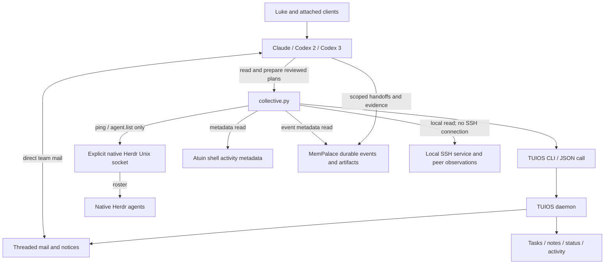
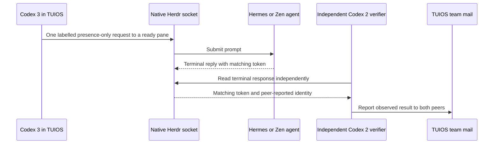

# Communication layers

The collective joins existing communication systems. Each retains its own addressing, authority and persistence. Shared context comes from explicit handoffs and recorded evidence; agents do not share a literal mind or run continuously merely because a timer is active.

[[Home]] · [[Architecture/Write lifecycle]] · [[Architecture/Runtime and recovery]] · [[Evidence/Verification]]

## Implemented architecture

The Python source and manifest exist in `~/tuios-setup/collective-plugin`. The plugin is not registered or enabled. Its commands can be run directly; its heartbeat is separately installed as a user timer. Live roster reads have joined three TUIOS peers with 22 native Herdr agents.

Shareable diagram exports: [Components](Rendered/communication.svg) · [Peer test sequence](Rendered/peer-sequence.svg). Regenerate these from this note when the source diagram changes.

## Address and lifetime map

| Layer | Address | Suitable use | Persistence and limits |
|---|---|---|---|
| TUIOS mail | Server + session + full pane UUID + thread/message ID | Non-interrupting peer messages and replies | Daemon-memory ring; receipt is not acceptance; wake is distinct from delivery |
| TUIOS tasks and notes | Session + card/pane | Work ownership, stage and visible intent | Saved session state; not a universal cross-harness log |
| Native Herdr | Native socket/server + `w*:p*` pane ID | Roster and scoped peer interaction | No native threaded mailbox exposed in the inspected protocol; terminal replies require readback |
| MemPalace | Hub + event ID + correlation + exact pane metadata | Durable outcomes, task/patch handoffs | Append-only events; shared `kinoite-codex` label does not distinguish sessions |
| Atuin | Local history record + author/session/cwd | Evidence of recorded shell activity | Some hooks already capture activity; not proof of every tool call; thread capture and sync were disabled at survey time |
| SSH | Verified endpoint/account + scoped path or command | Remote exec/files and the existing laptop coordination directory | Transport alone does not establish agent identity or acceptance |

TUIOS pane UUIDs and native Herdr pane IDs are different namespaces. The visible TUIOS pane can inherit stale native Herdr environment values. Discover and corroborate the current route rather than treating an inherited variable or display name as identity proof.

## What was tested

Tokens `COLLECTIVE-TACO-20261104` and `COLLECTIVE-ZEN-20261104` were observed in `w1:p4` and `w1:p5`. This proves socket submission through peer response and terminal readback. It does **not** prove a native peer directly sent TUIOS return mail. The peer names remain claims, not cryptographic identities. The native prompt test was performed by the coordinator outside the plugin's read-only native-socket adapter.

## Collaboration workflow

One intake names an owner, a reviewer, a goal, file scope, acceptance criteria and evidence. Agents update pane notes for current intent and send peer mail for milestones, failures and handoffs. `collaboration-plan` supplies a structured message for intent, milestone, blocker, handoff or review, using the same mail-plan/apply boundary described in [[Architecture/Write lifecycle]].

For substantial alternatives, TUIOS fan-out creates isolated worktrees with the same specification and checks. Verification, comparison and peer review precede integration. No candidate is selected solely because it says it is done. Fan cleanup may discard ignored files; preserve evidence and inspect dirty siblings before keeping an attempt. Grants scope TUIOS operations and are not a filesystem sandbox.

## Documentation and open paths

The official [TUIOS messaging](https://tuios.dev/docs/agent-messaging), [control protocol](https://tuios.dev/docs/control-protocol), [remote hosts](https://tuios.dev/docs/remote-hosts) and [Herdr plugin](https://herdr.dev/tui/docs/plugins/) documentation describe additional options. Installed schemas govern exact availability: TUIOS 0.12.0 exposed 191 verbs during this survey, while a web page still listed 115.

Browser/phone access, third-party HTTPS courier, new remote-host links, durable event bridges and expanded native write actions are documented or proposed capabilities, not configured or proven routes here. A future collective plugin panel can surface these layers; no panel is active just because its design appears in this vault.

## Change discipline

Update the dated verification note when a route changes. Keep historical test evidence dated; never promote it silently to current readiness. Do not store message bodies, credentials or tokens in architecture notes.
