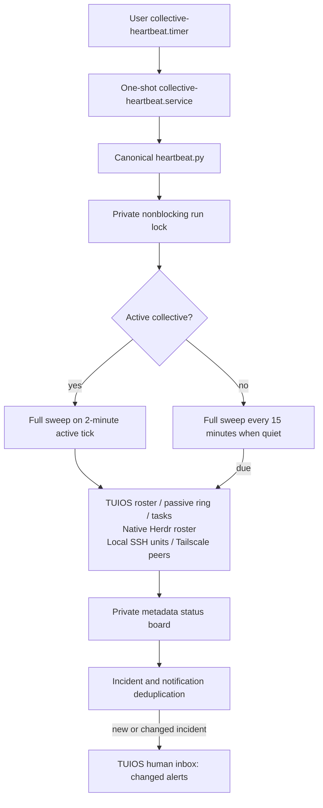
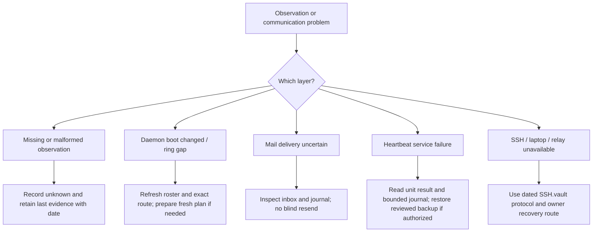

# Runtime and recovery

The plugin source and the installed scheduler have separate lifecycles. Running the heartbeat does not register the plugin, and a timer does not supply continuous agent reasoning.

[[Home]] · [[Architecture/Communication layers]] · [[Architecture/Write lifecycle]] · [[Operations/Reference workflow]] · [[Evidence/Verification]]

## Current desktop deployment



| Artifact | Path / behaviour |
|---|---|
| Canonical source | `~/tuios-setup/collective-plugin/` |
| Service source | `heartbeat.py`, adopted by Codex 3 from Claude's reviewed implementation |
| User units | `~/.config/systemd/user/collective-heartbeat.service` and `.timer` |
| Execution | `/usr/bin/python3 -I ~/tuios-setup/collective-plugin/heartbeat.py` |
| Cadence | Two-minute timer tick with bounded random delay; full checks on active ticks, every fifteen minutes when quiet |
| State | `~/.local/state/collective/`: private board, incident/dedup memory and lock |
| Install receipt and backups | `~/.local/state/collective-plugin/scheduler-install-receipt.json` and `scheduler-backups/` |
| Activation boundary | One user timer, installed and enabled. It was paused by root (stopped) during the hardening pipeline, then reinstalled and observed active after local host acceptance on 2026-11-05 (dated evidence in [[Evidence/Verification]]). A future pause is lifted only after an accepted deployment; query current state with `systemctl --user is-active collective-heartbeat.timer`. The plugin is enabled in tuios and native herdr for read-only actions (`proof/plugin-activation.json`) |

The systemd user manager's availability governs this timer. It is not proof of operation before login, after reboot, after encrypted-storage lock or while the machine is powered off. No new linger or boot-unlock behaviour was configured.

Shareable diagram exports: [Runtime](Rendered/runtime.svg) · [Recovery](Rendered/recovery.svg). Regenerate these from this note when the source diagram changes.

## Heartbeat semantics

- A run reads metadata; it does not mark a pane's inbox read or seen, type into panes, answer approvals or generate peer replies.
- Recent mail, in-flight task cards and `needs_you` can make the collective active. Raw ring data may be read internally to inspect timestamps, but message text is not used as an instruction or written into the board.
- Stale unread mail, long waits, native-agent blocking, observed peer state changes and existing relay failures can produce change-only human notices. An online Tailscale peer is not verified agent or SSH reachability.
- Invalid or unavailable observations are unknown. Native response parsing checks shape and correlation; a malformed response must not crash the healthy TUIOS view.
- Locking bounds overlap. Subprocess timeouts and the service deadline bound work. Private files and atomic replacement preserve state without recording message bodies.
- Recurring checks help reveal stalled communication; agents process messages during active turns or a supported harness wake. No perpetual model worker is implied.

## Failure and recovery map



Read-only inspection:

```sh
systemctl --user status collective-heartbeat.timer collective-heartbeat.service
systemctl --user list-timers collective-heartbeat.timer --no-pager
journalctl --user -u collective-heartbeat.service -n 30 --no-pager
```

The off switch is `systemctl --user disable --now collective-heartbeat.timer`. Changing or restoring units is an explicit operational action; use the install receipt and owner-held backups rather than improvising a second scheduler. `install_monitor.py` defaults to printing the proposed units; its `--install` path is a separate scoped scheduler change, not plugin activation.

## Remote transport boundary

SSH.vault records native LAN and managed Tailscale acceptance on 25 October 2026. Those are historical tests, not a current remote connection result. The current sweep observed the laptop offline and relay system units repeatedly failing; no fresh remote connection was attempted. Independent public/interstate recovery remains unqualified.

The established laptop coordination directory is `~/.local/state/ssh-hardening/coordination/`, carried over authenticated SSH with atomic mode-0600 messages, explicit scope and read/applied/verified/blocked states. A future TUIOS host link would complement that route, not silently replace it or turn the mail ring into durable storage.

Authoritative source notes:

- `~/SSH.vault/Operations/SSH team security and working protocol.md`
- `~/SSH.vault/Operations/Travel developer access and independent recovery.md`
- `~/SSH.vault/Operations/Host Trust Verification and Pending Laptop Operator Run 2026-10-28.md`

The Herdr SSH MCPv2 planning note records source-present/inactive code, not a deployed remote actuation channel. Never derive fresh SSH readiness from a screenshot, matching username, active service or architecture drawing.
