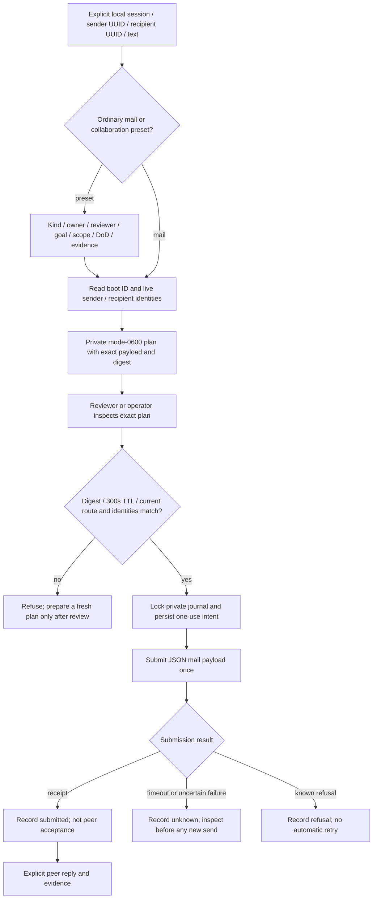
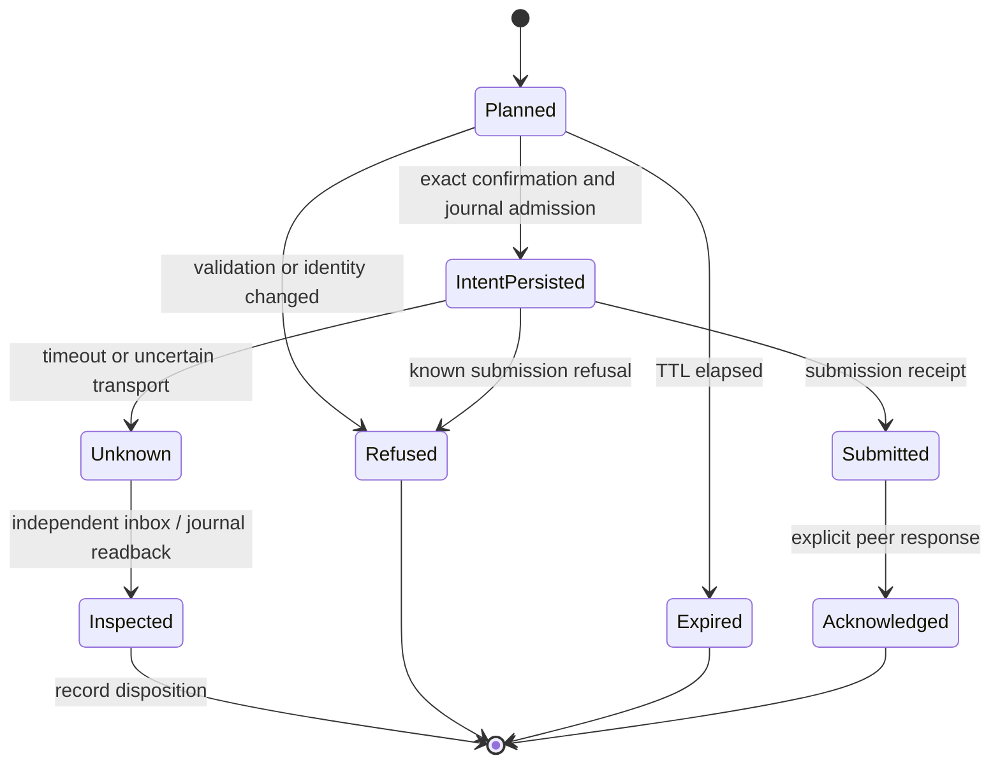

# Write lifecycle

The canonical plugin implements one deliberate write lane: reviewed local TUIOS mail. A collaboration preset formats the handoff but grants no additional authority.

[[Home]] · [[Architecture/Communication layers]] · [[Architecture/Runtime and recovery]] · [[Evidence/Verification]]

## Plan, validate, consume, submit

`make_collaboration_plan` accepts `intent`, `milestone`, `blocker`, `handoff` or `review`. Its JSON body carries owner, reviewer, goal, scope, definition of done and evidence references. The owner and reviewer must be distinct live panes. It delegates to `make_mail_plan`; it is not a second sender.

Shareable diagram exports: [Write flow](Rendered/write-flow.svg) · [Write states](Rendered/write-state.svg). Regenerate these from this note when the source diagram changes.

## Binding and safety controls

| Boundary | Implemented control | What it does not prove |
|---|---|---|
| Payload | Exact schema; UTF-8 byte limits; control/bidi refusal; body stays JSON data | Content is trustworthy or safe to follow as instructions |
| Route | Explicit local session; current endpoint/boot; sender and recipient pane/session/foreground/harness | Authenticated identity of a model or atomic validation-and-send |
| Review | Exact SHA-256 digest and 300-second lifetime | Cryptographic authorization from Luke |
| Replay | Private locked journal; one-use digest and request nonce; intent before submission | Recipient accepted the request |
| Local files | Owner/mode/regular-file/link checks, no symlink following; validate before truncation | Protection from arbitrary same-user code or writable ancestor races outside the stated checks |
| Execution | Argument-vector subprocess and structured JSON, no shell evaluation | A downstream recipient cannot act on the message |
| Uncertainty | Timeout recorded as unknown, with no blind automatic resend | A timed-out request definitely failed to arrive |

The plan contains the body in a private file. Successful CLI apply removes that plan by default; `--keep-plan` retains it. Unknown/refused outcomes require inspection. The journal records metadata and body hash/length rather than the body. Retained plans and private state still need an operator-approved retention policy.

## State transitions

`Acknowledged` and `Inspected` describe the team workflow, not automatic transitions implemented by the mail helper. There is no automatic acknowledgement or retry worker.

## Verification evidence

The frozen test suite includes replay, same nonce with changed payload, a four-process consume race with one winner, timeout without retry, hardlink/symlink/mode refusal, preservation of rejected output-file bytes, shell-like text preserved as JSON data, passive inbox behaviour, monitor restart/deduplication, malformed native responses and collaboration field preservation.

The malformed-response tests were first observed failing with uncaught `AttributeError`, then passed after explicit shape guards were added. Claude independently tested scratch-copy mutations of digest and replay controls. Exact source fingerprints, verifier observations and limitations belong in [[Evidence/Verification]]; a test count alone is not a security or deployment qualification.

## Excluded write effects

The plugin does not provide raw PTY input, queued agent prompts, broadcast, human approval impersonation, native Herdr prompt writes, SSH effects, grant/config changes, script execution or automatic replies. Separate authorized native-peer communication tests do not silently enable these in the plugin.

An expanded write capability needs its own bounded contract, owner/reviewer, refusal cases, test evidence and an explicit adoption decision. Existing user authorization should be used where it covers the task; a design document is not additional authority.
