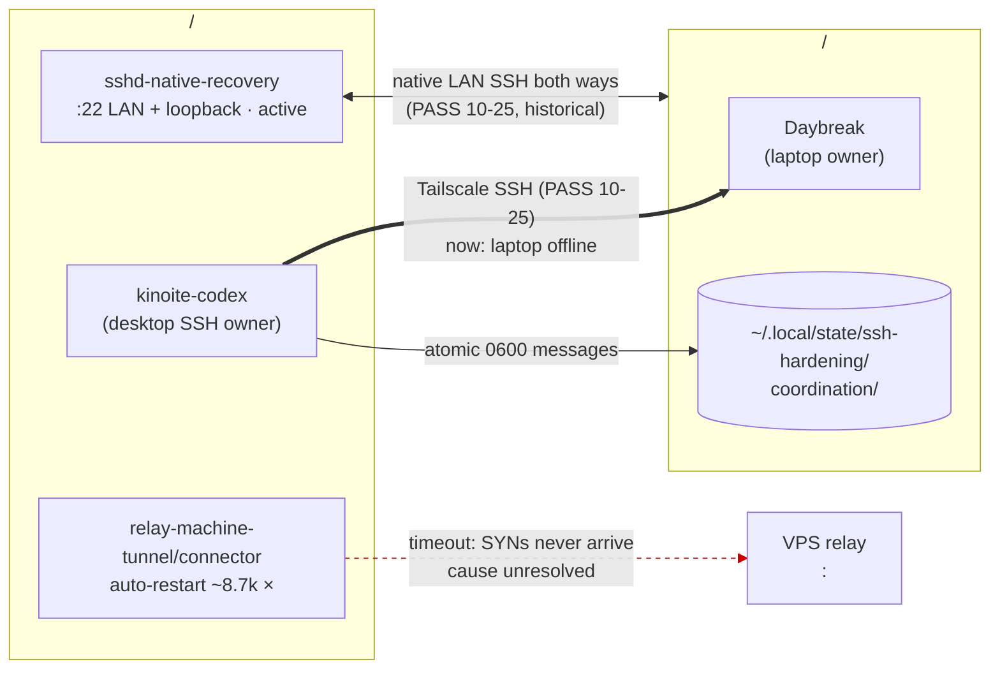

# SSH state (cross-machine)

> Addresses are redacted for publication. Real endpoints, pins and keys live only in the private `SSH.vault` under the SSH team protocol.

| Path | Recorded | Now (2026-11-04) |
|---|---|---|
| Tailscale SSH desktop→laptop | PASS 2026-10-25 | Laptop offline since 06:00Z |
| Native LAN, both ways | PASS 2026-10-25 (historical) | Desktop listener active; laptop untestable |
| Offsite relay | Design deployed; public path times out | Units restart-looping (alert in the heartbeat) |
| tuios host link | Not configured | Proposed, mail-only, needs Luke + both SSH owners |

The **SSH team protocol** (CLAUDE.local.md and SSH.vault) governs. This vault only reports SSH state. The D3 relay stop is authorised but awaits Luke's `sudo`; D4 is done in metadata only. See [[Operations/Open Decisions]].
