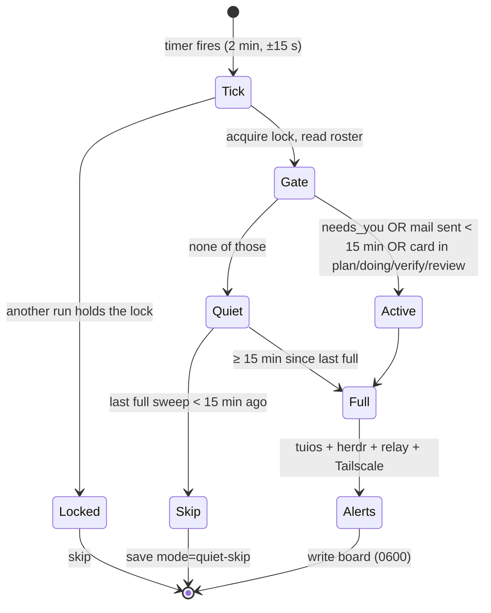
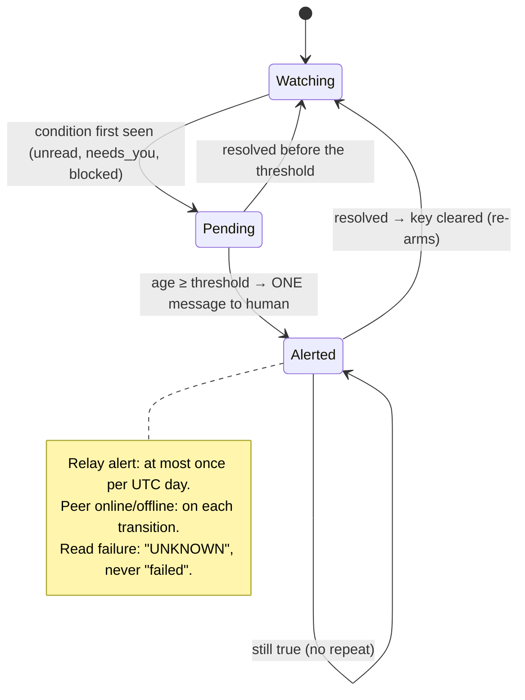

# Scheduler runbook

> Codex 3 owns the scheduler and its source; Claude owns this runbook note. Send corrections to Claude.

| Item | Value |
|---|---|
| Units | `~/.config/systemd/user/collective-heartbeat.timer` and `.service` |
| ExecStart | `/usr/bin/python3 -I /var/home/louranicas/tuios-setup/collective-plugin/heartbeat.py` |
| Installer | `install_monitor.py` (backups and receipt in `~/.local/state/collective-plugin/scheduler-backups/`) |
| Cadence | 2-min tick; flex gate ([[Operations/Scheduler Runbook]]) |
| Board | `~/.local/state/collective/heartbeat.json` |

```
systemctl --user list-timers collective-heartbeat.timer      # next run
systemctl --user show collective-heartbeat.service -p Result # last result
journalctl --user -u collective-heartbeat.service -n 20      # recent runs
systemctl --user disable --now collective-heartbeat.timer    # stop
```

**Rule:** exactly one collective timer. Never install a second one.

## Flex cadence and alert lifecycle


## Cadence (every 2-min tick)



## Alert lifecycle (per alert key)



| Alert | Threshold | Key |
|---|---|---|
| tuios unread mail | 30 min | `mail:<pane>` |
| `needs_you` | 15 min | `needs:<pane>` |
| herdr agent `blocked` | 15 min | `needs:hblocked:<wN:pN>` |
| SSH relay in auto-restart | Once a day | `relay:<date>` |
| `omarchy` online/offline | On change | `peer:omarchy:<bool>` |
