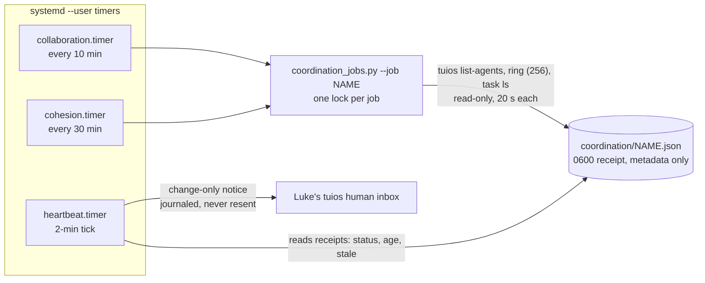
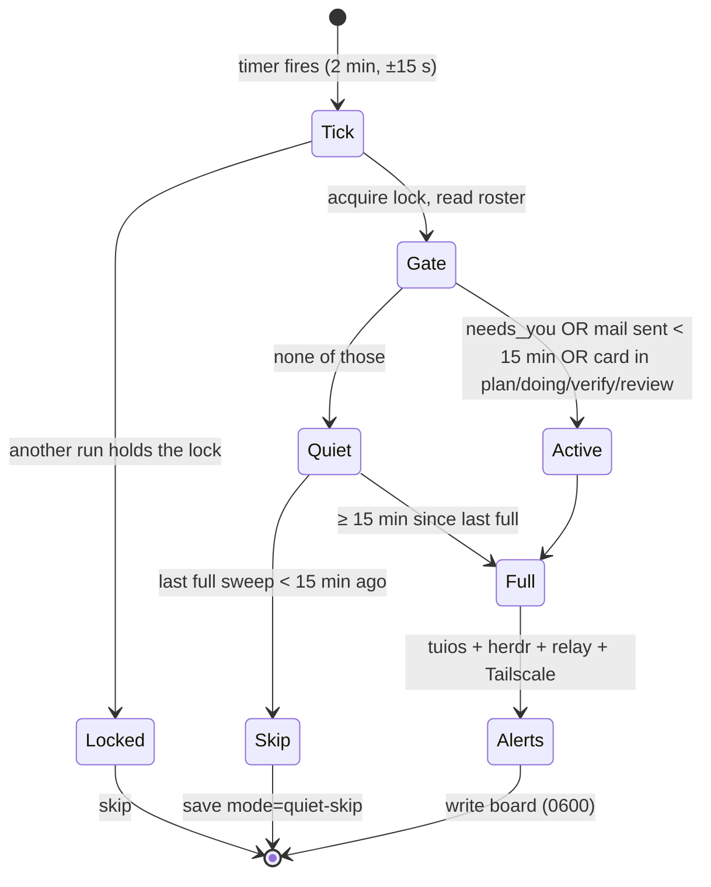
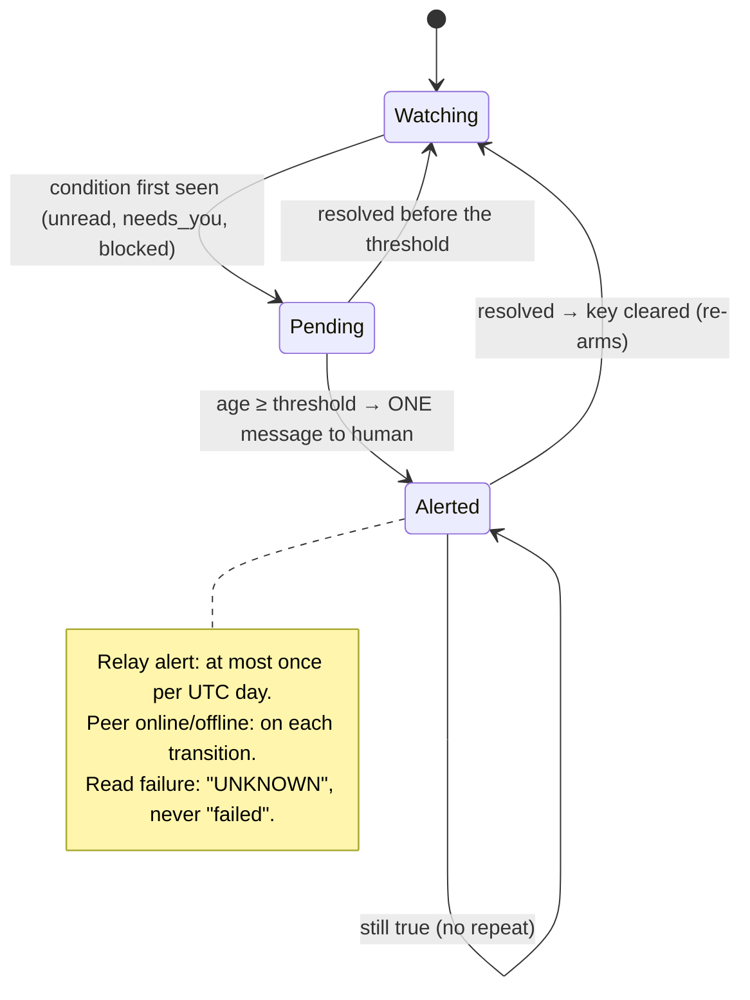
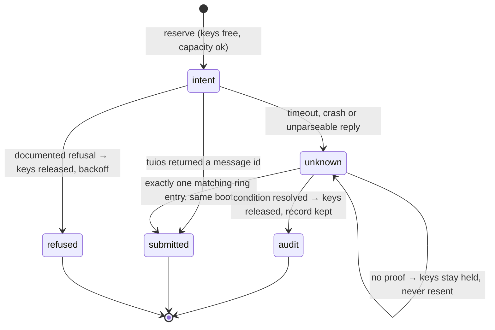

# Scheduler runbook

> Codex 3 owns the scheduler and its source; Claude owns this runbook note. Send corrections to Claude.

| Item | Value |
|---|---|
| Units | `~/.config/systemd/user/collective-heartbeat.timer` and `.service` (the **notification gateway**), plus `collective-{collaboration,cohesion}.{timer,service}` (bounded metadata-only jobs, see below) |
| ExecStart | `/usr/bin/python3 -I ~/tuios-setup/collective-plugin/heartbeat.py` |
| Installer | `install_monitor.py`: unit backups in `~/.local/state/collective-plugin/scheduler-backups/<UTC>-<id>/`; receipt at `~/.local/state/collective-plugin/scheduler-install-receipt.json` |
| Cadence | 2-min tick; flex gate ([[Operations/Scheduler Runbook]]) |
| Board | `~/.local/state/collective/heartbeat.json` |

```
systemctl --user list-timers collective-heartbeat.timer      # next run
systemctl --user show collective-heartbeat.service -p Result # last result
journalctl --user -u collective-heartbeat.service -n 20      # recent runs
systemctl --user disable --now collective-heartbeat.timer    # stop
```

**Rule (revised 2026-11-05, Codex 3 decision #582):** exactly **one notification gateway**, the heartbeat. Only it may message Luke's `human` inbox. Two bounded metadata-only job timers observe and write private receipts. They never notify, send mail, wake agents, type into panes or start model turns. Never add a second notifier. Earlier rule, kept as history: "exactly one collective timer".

**Status:** in the candidate host acceptance on 2026-11-04T20:59Z (2026-11-05 local), the gateway installer resumed the heartbeat and `install_coordination_jobs.py` installed the two job timers. Earlier on 2026-11-05 the heartbeat was paused for hardening and the jobs were not installed. This line is dated evidence, not live state. Query the live state:

```
systemctl --user is-active collective-heartbeat.timer collective-collaboration.timer collective-cohesion.timer
```

## Gateway and jobs



| Job | Cadence | Bounds | Does | Receipt is stale after |
|---|---|---|---|---|
| `collaboration` | `OnBootSec=3min`, then every 10 min, plus a random delay of up to 30 s | 90 s, 256 MB | Metadata snapshot: agent states, `draft_held`, `needs_you`, task stages, owners and holders, ring stored, read and reply-link counts, threads with and without reply links | 30 min |
| `cohesion` | `OnBootSec=3min`, then every 30 min, plus a random delay of up to 30 s | 90 s, 256 MB | The same snapshot on a slower rhythm | 90 min |

- **Receipts** go to `~/.local/state/collective/coordination/<job>.json` (schema 1, 0600). A receipt holds `status` (`ok`, `degraded` or `failed`), `source_gaps`, `metric_gaps`, the metrics and the job's `source_sha256`. A busy lock gives `skipped: already_running`.
- **Meaning.** Metrics are descriptive. Submission, read flags, replies, owner names and task stages are claims. **Acceptance and completion are never inferred** from them, and the ring is a bounded, volatile snapshot (`complete_history: false`), so evicted history is unknown. Absent owner or reviewer fields are reported as **unmeasured**, not as a defect. There is no coherence, resonance, phase, Gini or latency score.
- **No scheduled quality execution.** An earlier candidate had a daily `quality` job that ran the gates unattended. It was removed before release (Vesper review): it ran mutable checkout tests with live `HOME` and Unix-socket access, and its tool pins were not enforced. `coordination_jobs.py --job quality` is now refused. The quality interface is the explicit `tools/check.py` run by people, the pre-commit/pre-push hooks and protected CI. Daily quality automation is deliberately not shipped and no automatic quality result is claimed. Older private quality receipts are historical validation evidence, not job health, and the heartbeat ignores them. If a `collective-quality.timer` from a pre-release trial exists on a host, disable it: `systemctl --user disable --now collective-quality.timer`.
- **Heartbeat view.** Each sweep reads the installer receipt and the two job receipts. It reports `not-installed`, `observed` or `attention`. It raises `jobs:<name>` when a receipt is failed, degraded, unknown or stale.
- **First-run meaning (Codex 3, #630).** A **missing** receipt shortly after install reads `awaiting-first-run`, which means *no evidence yet*. It is **not a pass**, and nothing may be claimed green before a receipt exists. The window is 180 s from the installer receipt's `generated_utc` for both jobs. After its window, a still-missing receipt is `unknown` and alerts. A **malformed or unreadable** receipt is `unknown` at once, even inside the window. No job runs at install, and the timers have no startup clause.
- **Installer.** `install_coordination_jobs.py` (Codex 3) holds the same nonblocking `~/.local/state/collective-plugin/scheduler-install.lock` as `install_monitor.py` for its whole transaction, so neither installer can run while the other is changing user units. It verifies the staged units with `systemd-analyze --user verify` and backs up existing managed units to `coordination/installer-backups/<UTC>-<id>/`. It writes `installer.json` (`installing`, then `installed` or `rolled-back`), then enables only these two timers. When a step raises, it restores the prior units and each timer's enabled and active state. This is exception recovery: it is not atomic across power loss or SIGKILL, after which the `installing` receipt and the backups are the evidence for manual repair. It refuses to overwrite a unit it does not manage.
- **Off switch:** `systemctl --user disable --now collective-collaboration.timer collective-cohesion.timer`.

## Flex cadence and alert lifecycle


## Cadence (every 2-min tick)



## Alert lifecycle (per alert key)



| Alert | Threshold | Key |
|---|---|---|
| tuios unread mail | 30 min | `mail:<pane>` |
| `needs_you` | 15 min | `needs:<pane>` |
| herdr agent `blocked` | 15 min | `needs:hblocked:<wN:pN>` |
| SSH relay in auto-restart | Once a day | `relay:<date>` |
| Watched peer online/offline (`COLLECTIVE_WATCH_PEERS`) | On change | `peer:<host>:<bool>` |
| tuios ring evicted more messages in this daemon boot | On increase; reminder at most once per 48 h (`OBSOLETE_S`) | `ring-loss:<boot>` |
| tuios or herdr read failed | While failing (reported as UNKNOWN) | `tuios-read`, `herdr-read` |

- **Acknowledgements.** `mail:`, `needs:` and read-failure keys stay acknowledged while the condition is active or still tracked (including through a failed read) and are forgotten only on resolution. Relay-day, `ring-loss:` and peer-transition keys expire after `OBSOLETE_S` (48 h), so an unchanged ring loss reminds at most once per 48 h with the same boot key; a rising evicted count stays board metadata (`ring.evicted`).
- **Verified daemon restart.** When the tuios `boot_id` reads identically before and after the ring read and differs from the stored boot, tuios mail and `needs_you` ages and their acknowledgements are reset (herdr `hblocked:` tracking is kept). An unreadable or inconsistent boot preserves the stored state.
- **Sweep deadline.** All reads share one 45 s monotonic budget (`READ_BUDGET_S`; each tuios read at most 20 s, native herdr socket reads at most 10 s). The human notice keeps its own reserved 20 s (`NOTICE_S`), so the sweep finishes inside `TimeoutStartSec=90`. A read cut off by the budget reports UNKNOWN, never available.
- **Notice journal (supersedes the earlier "pending alerts" retry).** Each notice is reserved in `memory.json` as a durable **intent** before dispatch (it counts as `submitted` only on exit 0 with no non-null `error`, any `success` literally `true`, and a positive message id), with a request id, a body digest, its alert keys, the boot id and the endpoint. The outcome is then recorded as `submitted`, `refused` or `unknown`. A documented refusal is a known pre-effect outcome: it releases its keys and backs off (5 min doubling, at most 1 h) before a later attempt. A timeout, crash, missing binary, too-deep or unparseable reply leaves `unknown`: those keys are **held and an unknown notice is never automatically resent**. The heartbeat passively reconciles an `unknown` notice to `submitted` only when exactly one matching message is found in the same daemon boot's ring. Missing or evicted evidence never authorises a retry. When a held key's condition resolves (any `RESOLVABLE` prefix: `mail:`, `needs:`, `peer:`, `jobs:`, `tuios-read`, `herdr-read`), the key is released while the `unknown` record stays as audit; a later recurrence of that condition is a new alert and notifies once. A stored submission is not a read receipt or acceptance.
- **Legacy hold (pre-journal state).** A `memory.json` written before the journal existed, with a failed last attempt (`notice_failures > 0`), has no receipt binding, so no evidence can show whether that notice was delivered and no reconciliation is possible. The heartbeat fails closed: it sends **no** notice, keeps every alert unacknowledged, and shows `notifications.legacy_unknown_hold: true` and the issue text on the board. Operator procedure: (1) inspect Luke's `human` inbox for the last pre-upgrade heartbeat notice; (2) run `/usr/bin/python3 -I heartbeat.py --release-legacy-notice-hold` (add `--dry-run` first to preview: it changes no memory and writes no backup; only the heartbeat lock file may be created if it is absent). It takes the heartbeat lock, saves the prior memory to `~/.local/state/collective/memory.legacy-hold-<UTC>.json` (0600) and clears only the hold. It marks nothing sent, so every still-active alert notifies on the next sweep, possibly repeating the legacy notice. The 2026-11-05 host state had `notice_failures: 0`, so this path does not apply there.
- **Corrupt state (fail closed).** A **missing** `memory.json` is a first run and is allowed. A **present but unreadable, malformed or empty** `memory.json` stops every heartbeat run, including `--dry-run` and `--release-legacy-notice-hold`, with exit 1 before any read or notice. Python's own `JSONDecodeError` or `UnicodeDecodeError` is the diagnostic; there is no alert key, because a notice cannot be safely dispatched. The prior board and memory are left unchanged as evidence; nothing is reset and nothing is resent. The heartbeat is the only notifier, so **this failure is silent in the human inbox**. Detect it with `systemctl --user status collective-heartbeat.service` (failed, exit-code), the journal (`JSONDecodeError` or `UnicodeDecodeError`) or a board that has gone stale. Operator recovery: (1) copy `memory.json` aside as evidence; (2) inspect Luke's actual `human` inbox for the last heartbeat notices, because any notice whose outcome was `unknown` may already have been delivered; (3) restore a trusted, complete `memory.json` only with owner review. If no trusted state exists, **hold**: leave the heartbeat failing until the owner makes an explicit recovery decision that accepts possible duplicate notices. Never delete or reset the file as routine recovery: that is exactly the silent-resend path the halt prevents; (4) let the timer run and confirm the service succeeds and the board is fresh.



## Install receipt

`install_monitor.py --install` holds the shared installation lock and writes `scheduler-install-receipt.json` (0600) before it changes any unit:

| `status` | Meaning |
|---|---|
| `installing` | Attempt in progress; `previous` holds the last accepted (`installed`) receipt, or `null` |
| `installed` | Units written, timer enabled and started, service started. This is the accepted install |
| `rolled-back` | A step raised. Prior units, enablement and active state were restored (exception recovery, not power-loss atomicity); `error` is the original failure, `rollback_errors` lists any restore failures, and `previous` keeps the last accepted install |

After a failed reinstall, read `previous` for the install still in effect and `backup` for the failed attempt's unit backups. The installer re-raises the original error.

Watched Tailscale peers come from `COLLECTIVE_WATCH_PEERS` (comma-separated host names, empty by default) so no host name is published. Set it locally in a `systemctl --user edit collective-heartbeat.service` drop-in.
