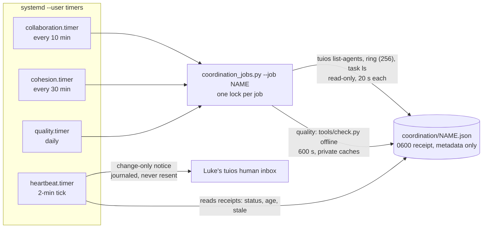
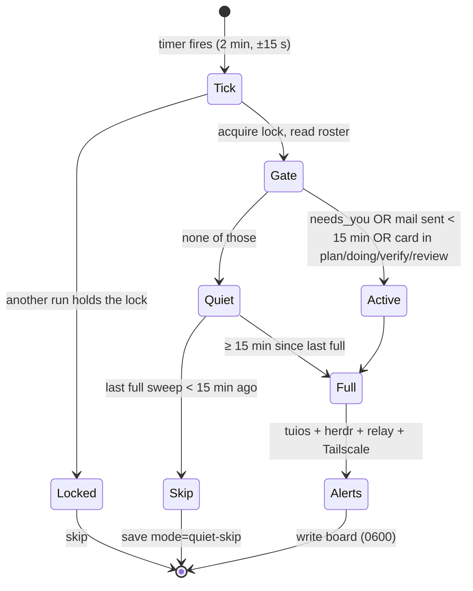
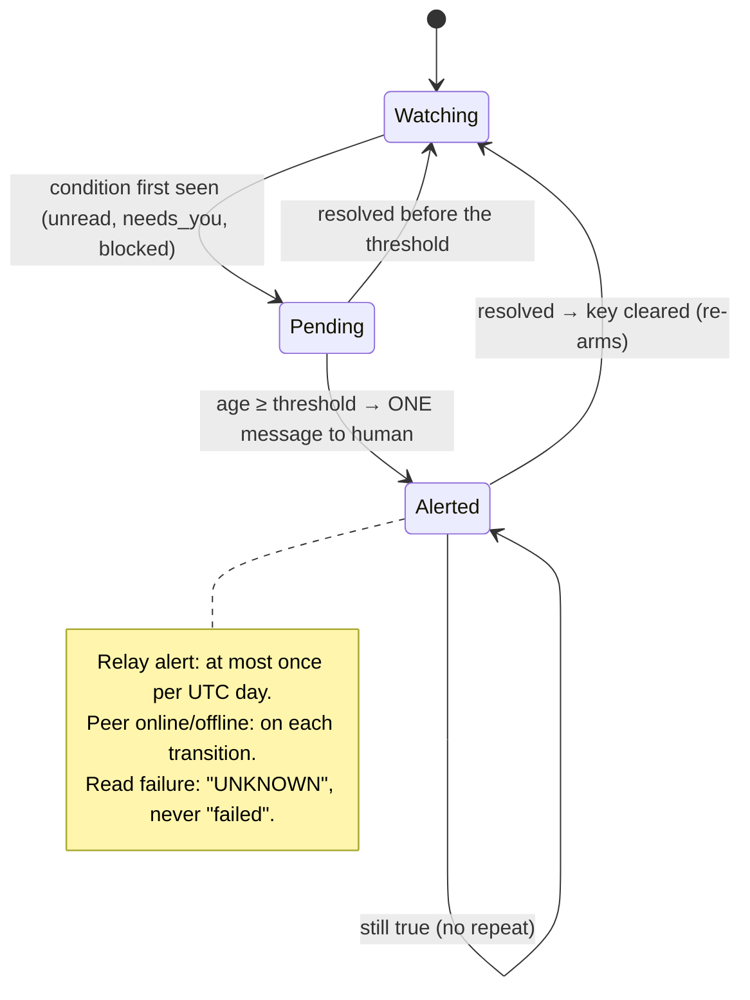
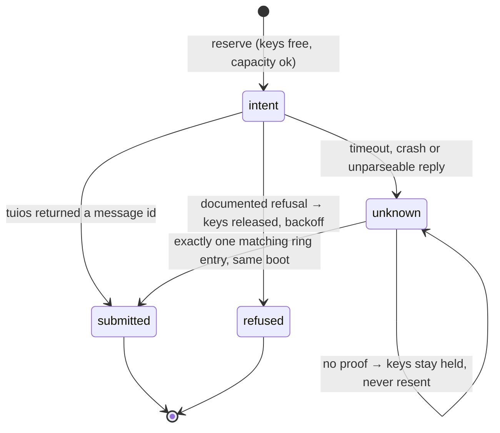

# Scheduler runbook

> Codex 3 owns the scheduler and its source; Claude owns this runbook note. Send corrections to Claude.

| Item | Value |
|---|---|
| Units | `~/.config/systemd/user/collective-heartbeat.timer` and `.service` (the **notification gateway**), plus `collective-{collaboration,cohesion,quality}.{timer,service}` (bounded jobs, see below) |
| ExecStart | `/usr/bin/python3 -I ~/tuios-setup/collective-plugin/heartbeat.py` |
| Installer | `install_monitor.py`: unit backups in `~/.local/state/collective-plugin/scheduler-backups/<UTC>-<id>/`; receipt at `~/.local/state/collective-plugin/scheduler-install-receipt.json` |
| Cadence | 2-min tick; flex gate ([[Operations/Scheduler Runbook]]) |
| Board | `~/.local/state/collective/heartbeat.json` |

```
systemctl --user list-timers collective-heartbeat.timer      # next run
systemctl --user show collective-heartbeat.service -p Result # last result
journalctl --user -u collective-heartbeat.service -n 20      # recent runs
systemctl --user disable --now collective-heartbeat.timer    # stop
```

**Rule (revised 2026-11-05, Codex 3 decision #582):** exactly **one notification gateway**, the heartbeat. Only it may message Luke's `human` inbox. Three bounded job timers observe and write private receipts. They never notify, send mail, wake agents, type into panes or start model turns. Never add a second notifier. Earlier rule, kept as history: "exactly one collective timer".

**Status on 2026-11-05:** the heartbeat timer was paused by Codex 3 during hardening and stays paused until host acceptance. The three job timers are **proposed and not installed**: `install_coordination_jobs.py` has not been run. Query the live state; do not trust this line:

```
systemctl --user is-active collective-heartbeat.timer collective-collaboration.timer collective-cohesion.timer collective-quality.timer
```

## Gateway and jobs



| Job | Cadence | Bounds | Does | Receipt is stale after |
|---|---|---|---|---|
| `collaboration` | `OnBootSec=3min`, then every 10 min, plus a random delay of up to 30 s | 90 s, 256 MB | Metadata snapshot: agent states, `draft_held`, `needs_you`, task stages, owners and holders, ring stored, read and reply-link counts, threads with and without reply links | 30 min |
| `cohesion` | `OnBootSec=3min`, then every 30 min, plus a random delay of up to 30 s | 90 s, 256 MB | The same snapshot on a slower rhythm | 90 min |
| `quality` | daily, plus a random delay of up to 30 s | 660 s for the service, 600 s for the command, 1 GB | `tools/check.py --keep-going` with `UV_OFFLINE=1`, private caches, and real gate tools provisioned at their exact pins into `coordination/gate-tools/bin`. No fetch, no fixes, no push. Output is not persisted | 48 h |

- **Receipts** go to `~/.local/state/collective/coordination/<job>.json` (schema 1, 0600). A receipt holds `status` (`ok`, `degraded` or `failed`), `source_gaps`, `metric_gaps`, the metrics and the job's `source_sha256`. A busy lock gives `skipped: already_running`.
- **Meaning.** Metrics are descriptive. Submission, read flags, replies, owner names and task stages are claims. **Acceptance and completion are never inferred** from them, and the ring is a bounded, volatile snapshot (`complete_history: false`), so evicted history is unknown. Absent owner or reviewer fields are reported as **unmeasured**, not as a defect. There is no coherence, resonance, phase, Gini or latency score.
- **Heartbeat view.** Each sweep reads the installer receipt and the three job receipts. It reports `not-installed`, `observed` or `attention`. It raises `jobs:<name>` when a receipt is failed, degraded, unknown or stale.
- **First-run meaning (Codex 3, #630).** A **missing** receipt shortly after install reads `awaiting-first-run`, which means *no evidence yet*. It is **not a pass**, and nothing may be claimed green before a receipt exists. The window is measured from the installer receipt's `generated_utc`:
  - collaboration and cohesion: 180 s;
  - quality: 25 h + 660 s + 30 s = 90,690 s. The daily timer does not run at install, and the window allows a 25-hour DST day, the service bound and the delay of up to 30 s.

  After its window, a still-missing receipt is `unknown` and alerts. A **malformed or unreadable** receipt is `unknown` at once, even inside the window. No job runs at install, and the timers have no startup clause.
- **Installer.** `install_coordination_jobs.py` (Codex 3) runs under an exclusive `installer.lock`. It verifies the staged units with `systemd-analyze --user verify` and backs up existing managed units to `coordination/installer-backups/<UTC>-<id>/`. It writes `installer.json` (`installing`, then `installed` or `rolled-back`), then enables only these three timers. On failure it restores the prior units and each timer's enabled and active state. It refuses to overwrite a unit it does not manage.
- **Off switch:** `systemctl --user disable --now collective-collaboration.timer collective-cohesion.timer collective-quality.timer`.

## Flex cadence and alert lifecycle


## Cadence (every 2-min tick)



## Alert lifecycle (per alert key)



| Alert | Threshold | Key |
|---|---|---|
| tuios unread mail | 30 min | `mail:<pane>` |
| `needs_you` | 15 min | `needs:<pane>` |
| herdr agent `blocked` | 15 min | `needs:hblocked:<wN:pN>` |
| SSH relay in auto-restart | Once a day | `relay:<date>` |
| Watched peer online/offline (`COLLECTIVE_WATCH_PEERS`) | On change | `peer:<host>:<bool>` |
| tuios ring evicted more messages in this daemon boot | On increase; reminder at most once per 48 h (`OBSOLETE_S`) | `ring-loss:<boot>` |
| tuios or herdr read failed | While failing (reported as UNKNOWN) | `tuios-read`, `herdr-read` |

- **Acknowledgements.** `mail:`, `needs:` and read-failure keys stay acknowledged while the condition is active or still tracked (including through a failed read) and are forgotten only on resolution. Relay-day, `ring-loss:` and peer-transition keys expire after `OBSOLETE_S` (48 h), so an unchanged ring loss reminds at most once per 48 h with the same boot key; a rising evicted count stays board metadata (`ring.evicted`).
- **Verified daemon restart.** When the tuios `boot_id` reads identically before and after the ring read and differs from the stored boot, tuios mail and `needs_you` ages and their acknowledgements are reset (herdr `hblocked:` tracking is kept). An unreadable or inconsistent boot preserves the stored state.
- **Sweep deadline.** All reads share one 45 s monotonic budget (`READ_BUDGET_S`; each tuios read at most 20 s, native herdr socket reads at most 10 s). The human notice keeps its own reserved 20 s (`NOTICE_S`), so the sweep finishes inside `TimeoutStartSec=90`. A read cut off by the budget reports UNKNOWN, never available.
- **Notice journal (supersedes the earlier "pending alerts" retry).** Each notice is reserved in `memory.json` as a durable **intent** before dispatch, with a request id, a body digest, its alert keys, the boot id and the endpoint. The outcome is then recorded as `submitted`, `refused` or `unknown`. Only a documented refusal releases its keys and backs off (5 min doubling, at most 1 h). A timeout, crash or unparseable reply leaves `unknown`: those keys are **held and never automatically resent**. The heartbeat passively reconciles an `unknown` notice to `submitted` only when exactly one matching message is found in the same daemon boot's ring. Missing or evicted evidence never authorises a retry. A stored submission is not a read receipt or acceptance.



## Install receipt

`install_monitor.py --install` writes `scheduler-install-receipt.json` (0600) before it changes any unit:

| `status` | Meaning |
|---|---|
| `installing` | Attempt in progress; `previous` holds the last accepted (`installed`) receipt, or `null` |
| `installed` | Units written, timer enabled and started, service started. This is the accepted install |
| `rolled-back` | A step failed. Prior units, enablement and active state were restored; `error` is the original failure, `rollback_errors` lists any restore failures, and `previous` keeps the last accepted install |

After a failed reinstall, read `previous` for the install still in effect and `backup` for the failed attempt's unit backups. The installer re-raises the original error.

Watched Tailscale peers come from `COLLECTIVE_WATCH_PEERS` (comma-separated host names, empty by default) so no host name is published. Set it locally in a `systemctl --user edit collective-heartbeat.service` drop-in.
