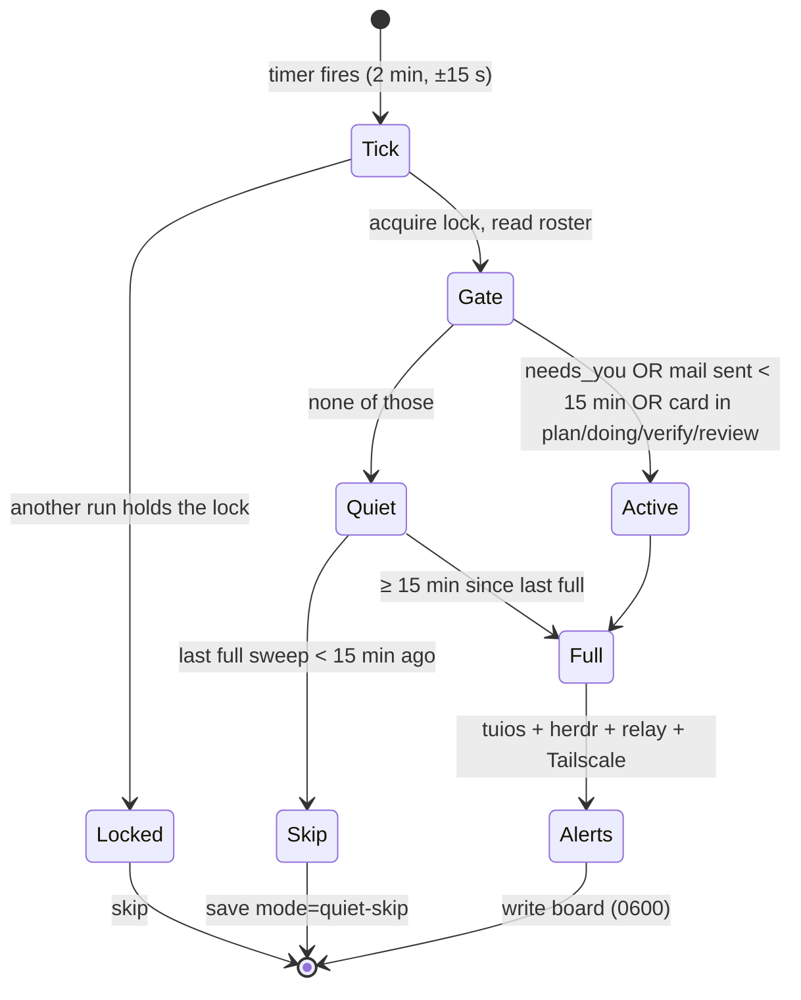
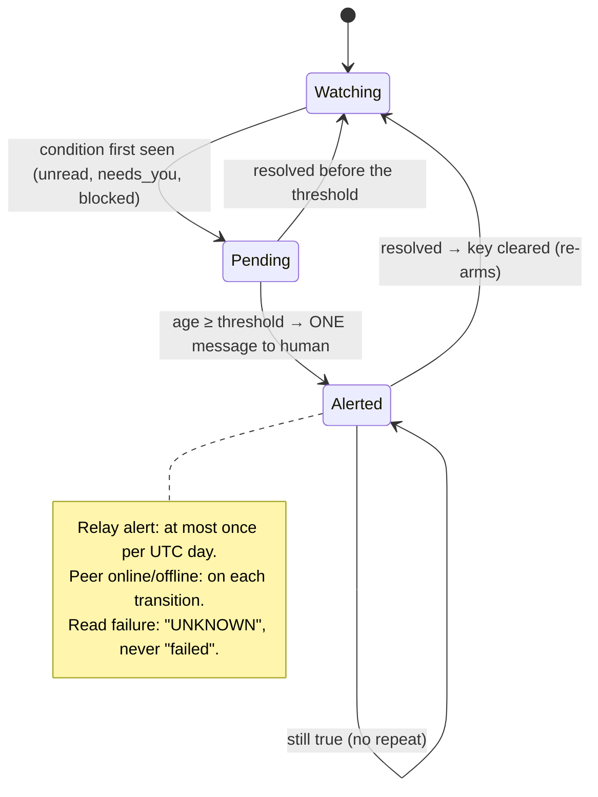

# Scheduler runbook

> Codex 3 owns the scheduler and its source; Claude owns this runbook note. Send corrections to Claude.

| Item | Value |
|---|---|
| Units | `~/.config/systemd/user/collective-heartbeat.timer` and `.service` |
| ExecStart | `/usr/bin/python3 -I ~/tuios-setup/collective-plugin/heartbeat.py` |
| Installer | `install_monitor.py`: unit backups in `~/.local/state/collective-plugin/scheduler-backups/<UTC>-<id>/`; receipt at `~/.local/state/collective-plugin/scheduler-install-receipt.json` |
| Cadence | 2-min tick; flex gate ([[Operations/Scheduler Runbook]]) |
| Board | `~/.local/state/collective/heartbeat.json` |

```
systemctl --user list-timers collective-heartbeat.timer      # next run
systemctl --user show collective-heartbeat.service -p Result # last result
journalctl --user -u collective-heartbeat.service -n 20      # recent runs
systemctl --user disable --now collective-heartbeat.timer    # stop
```

**Rule:** exactly one collective timer. Never install a second one.

## Flex cadence and alert lifecycle


## Cadence (every 2-min tick)



## Alert lifecycle (per alert key)



| Alert | Threshold | Key |
|---|---|---|
| tuios unread mail | 30 min | `mail:<pane>` |
| `needs_you` | 15 min | `needs:<pane>` |
| herdr agent `blocked` | 15 min | `needs:hblocked:<wN:pN>` |
| SSH relay in auto-restart | Once a day | `relay:<date>` |
| Watched peer online/offline (`COLLECTIVE_WATCH_PEERS`) | On change | `peer:<host>:<bool>` |
| tuios ring evicted more messages in this daemon boot | On increase; reminder at most once per 48 h (`OBSOLETE_S`) | `ring-loss:<boot>` |
| tuios or herdr read failed | While failing (reported as UNKNOWN) | `tuios-read`, `herdr-read` |

- **Acknowledgements.** `mail:`, `needs:` and read-failure keys stay acknowledged while the condition is active or still tracked (including through a failed read) and are forgotten only on resolution. Relay-day, `ring-loss:` and peer-transition keys expire after `OBSOLETE_S` (48 h), so an unchanged ring loss reminds at most once per 48 h with the same boot key; a rising evicted count stays board metadata (`ring.evicted`).
- **Verified daemon restart.** When the tuios `boot_id` reads identically before and after the ring read and differs from the stored boot, tuios mail and `needs_you` ages and their acknowledgements are reset (herdr `hblocked:` tracking is kept). An unreadable or inconsistent boot preserves the stored state.
- **Sweep deadline.** All reads share one 45 s monotonic budget (`READ_BUDGET_S`; each tuios read at most 20 s, native herdr socket reads at most 10 s). The human notice keeps its own reserved 20 s (`NOTICE_S`), so the sweep finishes inside `TimeoutStartSec=90`. A read cut off by the budget reports UNKNOWN, never available.
- **Pending alerts.** One-shot `peer:` and `ring-loss:` alerts are written to `memory.json` as `pending` before the notice is sent and are dropped only once a notice carrying them is delivered; an undelivered alert is retried on a later full sweep, subject to the notice-failure backoff.

## Install receipt

`install_monitor.py --install` writes `scheduler-install-receipt.json` (0600) before it changes any unit:

| `status` | Meaning |
|---|---|
| `installing` | Attempt in progress; `previous` holds the last accepted (`installed`) receipt, or `null` |
| `installed` | Units written, timer enabled and started, service started. This is the accepted install |
| `rolled-back` | A step failed. Prior units, enablement and active state were restored; `error` is the original failure, `rollback_errors` lists any restore failures, and `previous` keeps the last accepted install |

After a failed reinstall, read `previous` for the install still in effect and `backup` for the failed attempt's unit backups. The installer re-raises the original error.

Watched Tailscale peers come from `COLLECTIVE_WATCH_PEERS` (comma-separated host names, empty by default) so no host name is published. Set it locally in a `systemctl --user edit collective-heartbeat.service` drop-in.
